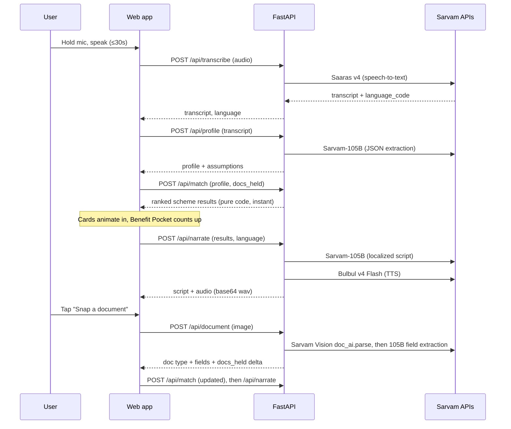
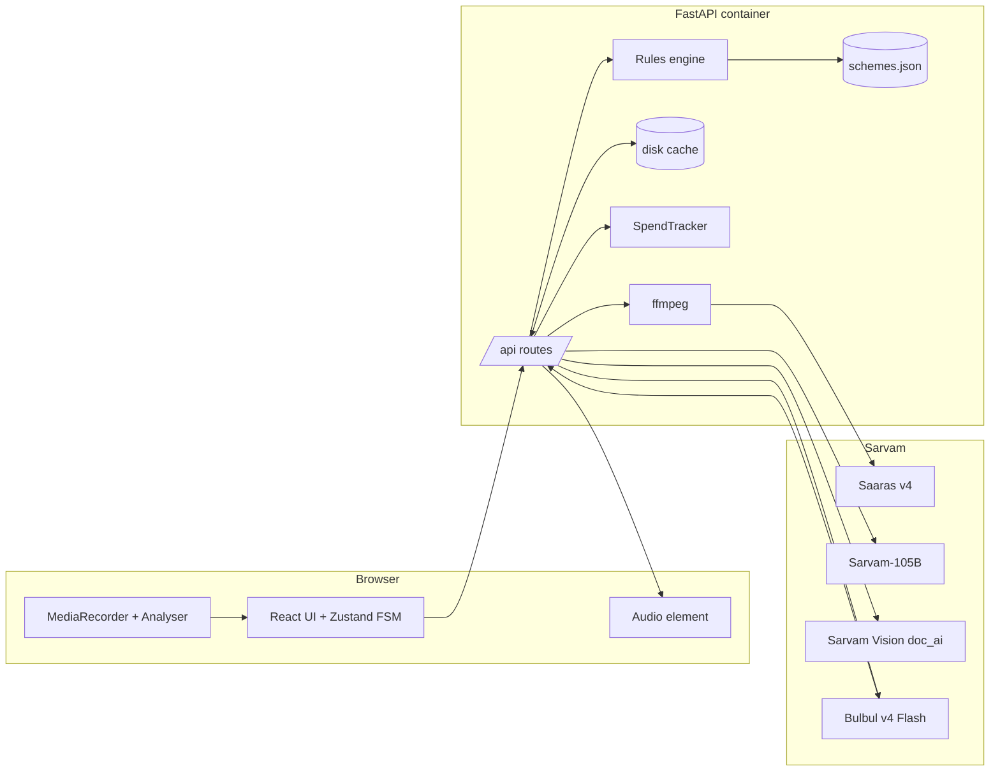

# Sarkari Sahayak (सरकारी सहायक) — Product & Engineering Spec

> **Tagline:** *Bolo. Dikhao. Suno.* — Speak. Show. Listen.
> **One-liner:** Your government benefits, explained in your own voice and language.
> **Doc status:** v1.0 baseline. Last reviewed 2026-11-03. This is the source of truth for the build.
> **Legend:** `[VERIFY]` marks a fact I could not confirm from docs. Check it during the phase named in §17 before you rely on it.

---

## 0. TL;DR

A voice-first web app. A person describes their life in any Indian language, for example *"I drive for Rapido, earn about 15k, have two kids, and my mother is 68."* The app does four things:

1. Transcribes the speech (**Saaras v4**).
2. Turns it into a structured, editable profile (**Sarvam-105B**).
3. Runs a **deterministic rules engine** over a curated scheme database to decide which schemes they qualify for, almost qualify for, or need to confirm.
4. Lets them photograph one document (**Sarvam Vision**) to flip "missing document" flags, then reads the verdict aloud in their language (**Bulbul v4 Flash**).

**Design principle:** the LLM understands and explains. Code decides eligibility. A model must never decide, on its own, whether someone gets a benefit.

---

## 1. Problem statement

### 1.1 The problem
Welfare benefits in India go unclaimed at scale. This is not for lack of schemes. Three frictions cause it:

| Friction | What happens on the ground |
|---|---|
| **Discovery** | There are hundreds of central and state schemes. People don't know which apply to their *combination* of age, occupation, income, state, and family. |
| **Language and literacy** | Portals and PDFs are English- or Hindi-first, text-heavy, and written in bureaucratic language. Many users are more comfortable *speaking* than reading or typing. |
| **Document readiness** | People go to a camp or bank and are turned away because of one missing document. That costs a day's wages and discourages them from trying again. |

### 1.2 Target user (primary persona)
**Ramesh, 34, Pune.** Rapido driver. Speaks Marathi and Hindi. Earns about ₹15,000 a month. Has a wife, two kids (a girl aged 6 and a boy aged 3), and a mother aged 68. Owns a smartphone with WhatsApp and UPI. Has an Aadhaar and a bank account. Doesn't know what e-Shram is.

Secondary personas: a woman farmer in Madhya Pradesh, a pregnant domestic worker in Tamil Nadu, and a retired 62-year-old in Odisha. These are used as test fixtures (§14).

### 1.3 Problem statement (formal)
> *Build a voice-first assistant that lets a person describe their situation in their own Indian language, and in under 60 seconds tells them, in that same language and in spoken form, which government schemes they likely qualify for, what each is worth, and exactly which document or step is missing for each.*

### 1.4 Success criteria
| Metric | Target |
|---|---|
| Speech → first scheme card visible (p50) | ≤ 8 s |
| Full flow Speak → Know (no scan) | ≤ 15 s to cards, ≤ 25 s to audio |
| Doc snap → updated verdicts | ≤ 25 s |
| Profile extraction accuracy on 5 golden personas | ≥ 90% of fields correct |
| Eligibility engine | 100% deterministic, 100% unit-test pass |
| Languages working end-to-end (voice in, voice out) | Hindi, Marathi, Tamil, Telugu, English as the tested set. 11 supported by config. |
| Cost per full session | ≤ ₹1.5 |
| Zero PII persisted | Yes, no audio, image, or transcript is stored server-side |

### 1.5 Non-goals
- Not an application-submission tool. We never file anything. We point to the official portal or office.
- Not legal or official eligibility advice. Every result is labelled *indicative*.
- No login, accounts, or database. No Aadhaar number collection.
- No real RAG over scheme PDFs. A curated JSON is more accurate and more auditable for this scope.
- No telephony/IVR in v1. This is a web app. (Stretch: WhatsApp/phone, §16.)
- No more than ~10 schemes in v1. Depth and correctness beat breadth.

---

## 2. Scope

### 2.1 In scope (MVP, P0)
1. Hold-to-talk voice input, with a typed-text fallback, 30 s max.
2. Auto language detection and an on-screen language chip.
3. Profile extraction to a typed schema, shown as **editable chips**.
4. A 10-scheme curated database with rules, benefit values, required documents, and where to apply.
5. A deterministic matching engine with four statuses (eligible, almost, confirm, not eligible).
6. A "Benefit Pocket" total that counts up.
7. A document snap: classify the document, extract key fields, mask IDs, and update held documents and profile fields.
8. A localized narration, written by the LLM from engine-verified facts, then spoken by Bulbul.
9. A demo/fixture mode: pre-baked persona buttons and cached responses, so the demo survives rate limits, bad Wi-Fi, or empty credits.
10. A credit-spend guard and a per-IP rate limit.

### 2.2 P1 (polish)
Streaming narration. A follow-up spoken question for "confirm" schemes ("Is your household on the BPL list?"). Shareable one-page summary (PNG) for WhatsApp. Light/dark toggle.

### 2.3 P2 (stretch, cut first)
WhatsApp bot using the same backend. Schema-based Document AI *Extract* in place of parse + LLM. Multi-document session. PWA install. Voice-activity auto-stop.

### 2.4 Cut-line rule
If you are behind schedule, cut in this order: P2 → P1 → doc-scan animation polish. **Never cut:** the rules engine, the editable chips, fixture mode, the disclaimer.

---

## 3. Users & key flows

### 3.1 Happy path


### 3.2 Alternate and edge flows
| Case | Behaviour |
|---|---|
| Mic denied / no mic | Show a text box and "Try a sample persona" buttons. |
| Silence or noise (STT returns empty or <3 words) | Friendly "I couldn't hear you, try again" with a shake animation. No LLM call is made, so credits are saved. |
| Language not supported by Bulbul (e.g. Urdu, Assamese) | Results text in detected language if 105B supports it, otherwise English. Audio falls back to `hi-IN`, with a toast explaining this. |
| Profile missing critical fields (age/state) | Chips show "Tap to add". Engine marks affected schemes `confirm`. Never guess silently. |
| User corrects a chip | Re-run `/api/match` only (free, instant). Re-narrate on demand. |
| Blurry or wrong document | Vision returns low confidence or `unknown`. UI: "Can't read this, try better light or flat surface". |
| Sarvam 429/503 | Exponential backoff, 3 tries. Then show the cached or fixture fallback if available. |
| Sarvam 402 (credits out) | Flip app to **fixture mode** automatically with a visible "Demo mode" pill. |
| Network drop mid-flow | State lives client-side, so retry resumes the failed step. |

---

## 4. Tech stack (decided)

| Layer | Choice | Why |
|---|---|---|
| Backend | **Python 3.11 + FastAPI + Uvicorn** | Official `sarvamai` Python SDK, async-friendly, auto OpenAPI docs, fast to write. |
| Sarvam access | `sarvamai` SDK, called via `asyncio.to_thread` | The sync SDK is the best-documented path. Threading avoids blocking the event loop. |
| Validation | **Pydantic v2** | Typed contracts for profile, scheme, and results, reused as the API schema. |
| HTTP (doc ZIP download) | `httpx` | Download the Vision output ZIP from the signed URL. |
| Audio transcode | **ffmpeg** (in container) | Browsers record webm/opus (Chrome) or mp4 (Safari). Normalize to 16 kHz mono WAV before STT. |
| Rate limiting | `slowapi` | Per-IP limits protect the 100-credit budget. |
| Tests | `pytest`, `pytest-asyncio`, `respx` (HTTP mocks) | Unit tests for rules and mocked contract tests. |
| Frontend | **React 18 + Vite + TypeScript** | Fast HMR, simple static build that FastAPI serves. |
| Styling | **Tailwind CSS** + CSS variables for theme tokens | Quick, consistent dark theme. |
| Animation | **Framer Motion** (cards, count-up, layout) + **Canvas/WebGL-free CSS** for the orb | Smooth and low-risk. No heavy 3D libs. |
| State | **Zustand** (single store + finite-state machine for the flow) | Tiny, no boilerplate. |
| Audio in | `MediaRecorder` + `AnalyserNode` (waveform drives the orb) | Native, no deps. |
| Audio out | One persistent `HTMLAudioElement`, unlocked on first tap | Avoids iOS/Safari autoplay blocks. |
| Fonts | Inter + Noto Sans (Devanagari, Tamil, Telugu, Bengali, Gujarati, Kannada, Malayalam, Gurmukhi, Oriya) | Correct rendering of Indic scripts. |
| Packaging | Single **Dockerfile** (multi-stage: node builds `dist/`, python image with ffmpeg serves API + static) | One deployable. |
| Hosting | **Render / Railway / Fly.io** (any container host) or Hugging Face Spaces (Docker) | HTTPS is required for `getUserMedia` on non-localhost. |
| Config | `.env` + `pydantic-settings` | Key never reaches the browser. |

**Rejected options:** Next.js (SSR is unnecessary, and the extra server layer adds a place to leak the key). Vanilla HTML (animation and state get messy by P1). WebSocket streaming STT (REST handles ≤30 s, which fits, and streaming doubles complexity). Vector DB or RAG (a 10-scheme JSON is exact, auditable, and free).

---

## 5. Sarvam model usage and cost

### 5.1 Models used
| Step | Model / API | Call | Notes |
|---|---|---|---|
| Speech → text | **`saaras:v4`** (v3 as fallback) | `client.speech_to_text.transcribe(file, model="saaras:v4", mode="transcribe")` | REST ≤ 30 s. Auto language detect. Returns transcript, plus a language code `[VERIFY response field name, likely language_code]`. |
| Profile + narration | **`sarvam-105b`** | `client.chat.completions(model="sarvam-105b", messages=[...])` | 128K context. Hybrid reasoning. 11 languages (10 Indian + English). |
| Document reading | **Sarvam Vision** via Document AI | `client.doc_ai.parse(file=[(name, f, mime)], language, output_format="md")` → poll `get_status` → `get_download_url` → ZIP (md + page JSON) | Async job. Poll every 2–3 s. PNG/JPG/PDF accepted. |
| Text → speech | **`bulbul:v4-flash`** | `client.text_to_speech.convert(text, language_code, model="bulbul:v4-flash", speaker=...)` | Returns `audios[]` of base64 WAV. 11 languages. Pick the speaker per language `[VERIFY speaker names, docs example uses simran_en_customer]`. |

> Use **Bulbul v4 Flash**, not v3: it is ₹1 per 1k characters against ₹3 for v3, and it has the same request/response contract.

### 5.2 Unit prices (pay-as-you-go, ex-GST)
STT ₹0.49/min · TTS v4-flash ₹1.00/1k chars · 105B ₹15 in / ₹60 out per 1M tokens (reasoning tokens bill as output) · Doc parse ₹0.50/page · Doc extract ₹1.00/page.

### 5.3 Cost per full session (estimate)
| Item | Assumption | ₹ |
|---|---|---|
| STT | 20 s | 0.16 |
| 105B profile | 1.5k in, 0.5k out | 0.05 |
| 105B narration | 1.5k in, 0.7k out | 0.065 |
| TTS | ~450 chars | 0.45 |
| Vision parse | 1 page | 0.50 |
| 105B doc fields | 1.5k in, 0.4k out | 0.05 |
| **Total** | | **≈ 1.3** |

### 5.4 Budget plan for ₹100
| Bucket | ₹ | Policy |
|---|---:|---|
| Development | 40 | Use fixtures and mocks. Live calls only in smoke tests, about ₹2 per run. |
| Rehearsal | 20 | About 15 full sessions. |
| Live demo | 15 | About 10 sessions. |
| Reserve | 25 | Do not touch until the demo is over. |

**Guards (must implement):**
- A `SpendTracker` adds the estimated ₹ per call and appends to `spend.log`. `/api/health` exposes the running total. A hard stop at `SPEND_CAP_INR` (default 85) forces fixture mode.
- Content-hash caches on disk: `hash(audio)→transcript`, `hash(transcript)→profile`, `hash(text+lang+speaker)→audio`, `hash(image)→doc result`. Repeated demo runs cost ₹0.
- Set `max_tokens` on every 105B call (profile 600, narration 900). Disable or lower reasoning if the API allows it `[VERIFY param name, e.g. reasoning_effort]`. Reasoning tokens bill as output.
- Persona buttons use canned transcripts (no STT cost). Vision is only called on a real user snap.
- Per-IP limit: 12 sessions/day and 30 requests/min. Optional `DEMO_PASSCODE` header gate for public deploys.

### 5.5 Rate limits to respect (pay-as-you-go)
STT REST 60/min · TTS 60/min · 105B 60/min · Doc AI parse: the pricing page says 200/min, but the Vision model page says 10/min `[VERIFY]`. Plan for 10/min and backoff on 429.

---

## 6. Architecture



**Key architecture decisions**
1. **Stateless server.** The client holds `{transcript, language, profile, docs_held, results}` and sends what each endpoint needs. No sessions or DB, which is simpler, more private, and trivially deployable.
2. **Engine is pure code.** `match(profile, docs_held, schemes) → results` has no I/O and is unit-tested. The LLM never outputs a verdict.
3. **LLM narrates only engine-verified facts.** The narration prompt receives the results JSON and may only rephrase it. A post-check verifies that every scheme name and rupee figure in the script exists in the input. On failure it retries once, then uses a template.
4. **Progressive UI.** Cards render the moment `/match` returns, and narration and audio arrive later. Perceived latency stays low.
5. **Fixture mode** is a first-class mode, switched by env, by credits exhausted, or by a UI toggle.

---

## 7. Repository layout

```
Sarvam/
├── SPEC.md
├── README.md
├── Dockerfile
├── .env.example
├── backend/
│   ├── pyproject.toml
│   ├── app/
│   │   ├── main.py              # FastAPI app, static mount, CORS, middleware
│   │   ├── config.py            # pydantic-settings
│   │   ├── models.py            # Profile, Scheme, Rule, Result, API DTOs
│   │   ├── routes/
│   │   │   ├── transcribe.py
│   │   │   ├── profile.py
│   │   │   ├── match.py
│   │   │   ├── document.py
│   │   │   ├── narrate.py
│   │   │   └── health.py
│   │   ├── services/
│   │   │   ├── sarvam.py        # thin wrapper: retries, timeouts, spend, to_thread
│   │   │   ├── audio.py         # ffmpeg normalize to 16k mono wav
│   │   │   ├── vision.py        # doc_ai job → zip → markdown/json
│   │   │   ├── llm.py           # prompts, JSON repair, validators
│   │   │   ├── tts.py           # sentence chunking, speaker map, fallback
│   │   │   ├── cache.py         # content-hash disk cache
│   │   │   └── spend.py
│   │   ├── engine/
│   │   │   ├── derive.py        # derived profile fields
│   │   │   ├── rules.py         # operators + evaluator
│   │   │   └── match.py         # status + ranking + pocket totals
│   │   └── data/
│   │       ├── schemes.json
│   │       ├── languages.json   # codes, names, scripts, tts speaker
│   │       └── fixtures/        # personas, canned responses, sample audio
│   └── tests/
│       ├── test_rules.py
│       ├── test_match_personas.py
│       ├── test_llm_parsing.py
│       └── test_routes_mocked.py
├── frontend/
│   ├── package.json  vite.config.ts  tailwind.config.ts
│   └── src/
│       ├── main.tsx  App.tsx
│       ├── store.ts             # Zustand + flow FSM
│       ├── api.ts               # typed client
│       ├── lib/ (audio.ts, image.ts, format.ts, i18n.ts)
│       └── components/
│           Orb.tsx  Transcript.tsx  LangChips.tsx  ProfileChips.tsx
│           SchemeCard.tsx  BenefitPocket.tsx  ScanSheet.tsx
│           Narrator.tsx  PersonaPicker.tsx  Disclaimer.tsx  Toasts.tsx
└── scripts/
    ├── smoke.py                 # one live call per API (~₹2)
    └── make_fixtures.py         # record real responses into fixtures
```

---

## 8. Data models

### 8.1 Profile
All fields are nullable. `null` means unknown, and unknown is not the same as "no".

```jsonc
{
  "age": 34,                          // self
  "gender": "male",                   // male|female|other
  "state": "MH",                      // ISO 3166-2:IN suffix
  "occupation": "gig_driver",         // enum below
  "monthly_income_inr": 15000,
  "household_size": 5,
  "dependents": [
    {"relation":"mother","age":68,"gender":"female"},
    {"relation":"daughter","age":6,"gender":"female"},
    {"relation":"son","age":3,"gender":"male"}
  ],
  "pregnant_or_lactating": false,
  "owns_farmland": false,
  "is_income_tax_payer": false,       // often INFERRED from income, flagged
  "is_epfo_esic_nps_member": false,
  "has_bank_account": true,
  "ration_card_type": null,           // bpl|aay|apl|none|null
  "docs_held": ["aadhaar","bank_passbook"],
  "inferred": ["is_income_tax_payer","is_epfo_esic_nps_member"]  // drives "assumed" chip style
}
```
`occupation` enum: `gig_driver, farmer, construction_worker, domestic_worker, street_vendor, small_shopkeeper, salaried_formal, homemaker, student, retired, unemployed, other`.

**Derived fields (computed in code, `engine/derive.py`)**: `annual_income_inr`, `has_member_60plus`, `has_member_70plus`, `has_girl_child_under_10`, `num_children`, `is_informal_worker` (derived from occupation), `age_group`.

### 8.2 Document type enum
`aadhaar, pan, bank_passbook, ration_card, income_certificate, domicile_certificate, age_proof, land_record, mgnrega_job_card, caste_certificate, mcp_card (mother-child protection card), voter_id, unknown`.

### 8.3 Scheme schema
```jsonc
{
  "id": "e_shram",
  "name": {"en": "e-Shram Card", "hi": "ई-श्रम कार्ड"},
  "level": "central",                  // central|state
  "states": null,                      // ["MP"] for state schemes
  "category": "labour",                // health|pension|insurance|maternity|farmer|women|labour
  "summary_en": "National ID for unorganised workers with ₹2 lakh accident insurance.",
  "benefit": {
    "kind": "cover",                   // cover|monthly|yearly|one_time|access
    "amount_inr": 200000,
    "label_en": "₹2 lakh accident cover",
    "counts_in_pocket": true
  },
  "rules": [
    {"id":"age","field":"age","op":"between","value":[16,59],"hard":true,"label_en":"Age 16–59"},
    {"id":"informal","field":"is_informal_worker","op":"is_true","hard":true,"label_en":"Works in the unorganised sector"},
    {"id":"nopf","field":"is_epfo_esic_nps_member","op":"is_false","hard":true,"label_en":"Not an EPFO/ESIC/NPS member"},
    {"id":"notax","field":"is_income_tax_payer","op":"is_false","hard":true,"label_en":"Not an income-tax payer"}
  ],
  "required_docs": ["aadhaar","bank_passbook"],
  "optional_docs": [],
  "how_to_apply_en": "Register free at eshram.gov.in or any CSC with Aadhaar and a mobile linked to Aadhaar.",
  "apply_url": "https://eshram.gov.in",
  "helpline": null,
  "source_url": "https://eshram.gov.in",
  "last_verified": "YYYY-MM-DD"       // MUST be filled in Phase 1
}
```
**Operators:** `eq, neq, in, not_in, gte, lte, between, is_true, is_false, exists`.
**Rule semantics (three-valued logic):** each rule evaluates to `pass`, `fail`, or `unknown`. `unknown` means the field is `null`.

### 8.4 Result
```jsonc
{
  "scheme_id": "e_shram",
  "status": "eligible",               // eligible|almost|confirm|not_eligible
  "rule_results": [{"id":"age","outcome":"pass","label_en":"Age 16–59"}],
  "missing_docs": [],                 // required_docs − docs_held
  "unknown_fields": [],               // fields that made `confirm`
  "failed_labels": [],                // for the "why not" section
  "benefit": { ... },
  "score": 87                         // for ranking
}
```
**Status decision table (evaluated in order):**
1. Any **hard** rule `fail` → `not_eligible`.
2. Any **hard** rule `unknown` → `confirm`, and the UI lists the unknown items as "Tell me / check: …".
3. All hard rules pass and `missing_docs` is non-empty → `almost`. The badge reads "Almost — N doc(s) missing".
4. All hard rules pass and `missing_docs` is empty → `eligible`.

**Ranking:** `eligible` before `almost` before `confirm`. Within a status, sort by benefit value, then by fewest missing docs. `not_eligible` goes to a collapsed "Not for you (and why)" section, which builds trust.

**Benefit Pocket:** sums `benefit.amount_inr` across `eligible` and `almost` schemes where `counts_in_pocket` is true, grouped by `kind` (`cover`, `monthly`, `yearly`). It displays "₹X lakh cover + ₹Y/month". It is labelled *up to*. Items with status `almost` show in a dimmer tone ("+₹Z more if you add 1 document"). `confirm` items are never counted.

---

## 9. Scheme database (v1, 10 schemes)

> ⚠️ Figures below come from my background knowledge and have **not** been re-verified against official sources in this session. **Phase 1 includes a mandatory verification pass.** Fill `last_verified` and `source_url` for each scheme. If a scheme can't be verified within the time-box, drop it. A wrong promise is worse than a missing scheme.

| # | id | Scheme | Level | Key hard rules (baseline) | Benefit | Required docs |
|---|---|---|---|---|---|---|
| 1 | `pmjay` | Ayushman Bharat PM-JAY | Central | Household in SECC/deprivation-criteria list `[VERIFY]`, gig-worker extension `[VERIFY]`. **Cannot be fully decided from speech, so status is almost always `confirm`**, with "check at pmjay.gov.in or call 14555". | ₹5 lakh/family/yr health cover | Aadhaar, ration card |
| 2 | `e_shram` | e-Shram | Central | Age 16–59, unorganised worker, not EPFO/ESIC/NPS, not tax payer | ₹2 lakh accident cover (via PMSBY) and a national ID | Aadhaar, bank passbook |
| 3 | `apy` | Atal Pension Yojana | Central | Age 18–40, has bank account, not tax payer | ₹1,000–5,000/month pension from age 60 | Aadhaar, bank passbook |
| 4 | `pmsby` | PM Suraksha Bima Yojana | Central | Age 18–70, has bank account | ₹2 lakh accident cover for about ₹20/yr | Aadhaar, bank passbook |
| 5 | `pmjjby` | PM Jeevan Jyoti Bima Yojana | Central | Age 18–50, has bank account | ₹2 lakh life cover for about ₹436/yr | Aadhaar, bank passbook |
| 6 | `pmmvy` | PM Matru Vandana Yojana | Central | Female, pregnant or lactating, first living child (₹6,000 total for a second girl child `[VERIFY]`) | ₹5,000 in instalments | Aadhaar, bank passbook, MCP card |
| 7 | `pm_kisan` | PM-KISAN | Central | Owns cultivable land, not an institutional/high-income landholder | ₹6,000/yr | Aadhaar, bank passbook, land record |
| 8 | `ignoaps` | Indira Gandhi Natl Old Age Pension | Central | Member aged 60+ (self or dependent), BPL household | ₹200–500/month central share (states top up) `[VERIFY]` | Aadhaar, age proof, ration card (BPL) |
| 9 | `ladli_behna` | Ladli Behna Yojana | MP | State = MP, female, age 21–60, family income < ₹2.5 lakh/yr `[VERIFY current rules and amount]` | ~₹1,250+/month `[VERIFY]` | Aadhaar, bank passbook (DBT-linked), domicile or samagra ID |
| 10 | `majhi_ladki_bahin` | Mukhyamantri Majhi Ladki Bahin | MH | State = MH, female, age 21–65, family income ≤ ₹2.5 lakh/yr `[VERIFY current status and amount]` | ~₹1,500/month `[VERIFY]` | Aadhaar, bank passbook, income cert or ration card, domicile |

**Why this set:** it spans health, pension, insurance, maternity, farmers, women, and old age. It mixes central and state schemes, so the *state* filter visibly works. It is also built around the demo persona: Ramesh gets e-Shram, APY, PMSBY, PMJJBY, PM-JAY (confirm) and IGNOAPS (confirm, BPL unknown). His wife's scheme, Majhi Ladki Bahin, is eligible only if she is the speaker.

**Data hygiene rules**
- Every scheme has `source_url` and `last_verified`. The UI footer shows "Scheme data last verified: <date>".
- Rules reflect *published* criteria only. When criteria are ambiguous or undeterminable, use `unknown` so the status becomes `confirm`. Don't fudge them into `pass`.
- Tax-payer and EPFO membership are **inferred** from income and occupation with `inferred: true`. They appear as an "assumed" chip the user can flip, and the engine re-runs.

---

## 10. Backend API contract

Base path `/api`. JSON unless noted. All errors use `{"error":{"code","message","retryable":bool}}`.

| # | Route | Request | Response | Sarvam call |
|---|---|---|---|---|
| 1 | `POST /api/transcribe` | multipart: `audio` (webm/mp4/wav, ≤5 MB, ≤30 s), optional `language_hint` | `{transcript, language_code, duration_s}` | Saaras v4 |
| 2 | `POST /api/profile` | `{transcript, language_code}` | `{profile, notes[]}` | 105B |
| 3 | `POST /api/match` | `{profile, docs_held[]}` | `{results[], pocket, generated_at, schemes_version}` | none (pure code) |
| 4 | `POST /api/document` | multipart: `image` (jpg/png ≤8 MB), `language_code`, optional `expected_doc_type` | `{doc_type, confidence, fields{}, profile_patch{}, docs_held_add[], masked_preview}` | Vision + 105B |
| 5 | `POST /api/narrate` | `{results, pocket, profile, language_code, speaker?}` | `{script, card_text{scheme_id:{why,next_step}}, audio_b64, audio_mime, tts_language_code, degraded?:bool}` | 105B + Bulbul |
| 6 | `GET /api/health` | none | `{ok, mode:"live"\|"fixtures", spend_inr, cap_inr, schemes_version}` | none |
| 7 | `GET /api/fixtures/personas` | none | list of canned personas (transcript, language, expected profile) | none |

**Behaviour requirements**
- Every route has a timeout: transcribe 20 s, profile 25 s, document 60 s, narrate 40 s.
- Idempotent and cache-aware via content hash. Add the header `X-Cache: HIT|MISS`.
- Responses never include raw transcripts or images in logs. Logs include route, latency, status, and estimated spend only.
- `/api/document` pipeline: normalize the image (strip EXIF, cap 1600 px, convert to JPEG) → `doc_ai.parse(output_format="md")` → poll `get_status` every 2.5 s, up to 45 s → `get_download_url` → download the ZIP → read the `.md` and page JSON → pass the text to 105B for **classification and field extraction** → return. If Vision times out, return a 504 with `retryable:true`.
- **Masking:** Aadhaar (12 digits), PAN, and account numbers are masked to the last 4 characters *server-side* before any value reaches the client or the LLM narration. Full IDs are never stored or spoken.
- Transcribe pipeline: ffmpeg → 16 kHz mono PCM WAV. Reject if the duration exceeds 30 s or the file exceeds 5 MB.

---

## 11. LLM prompts (contracts)

All 105B calls use a low temperature (0.1–0.2), `max_tokens` caps, and strict JSON output parsed by a tolerant parser. The parser strips code fences and `<think>` blocks, extracts the first balanced `{…}`, validates against Pydantic, and does one "repair" retry on failure.

### 11.1 Profile extraction
```
SYSTEM:
You extract a structured profile from a person's spoken description of their
life, for a government-benefits eligibility tool. The transcript may be in any
Indian language or code-mixed. Output ONLY valid JSON matching the schema.

RULES:
- Use null for anything not stated or not safely inferable. NEVER invent facts.
- Convert numbers said in words or in any Indian numeral system (e.g. "पंद्रह हज़ार",
  "15k", "१५०००", "दीड लाख") into integers. Income must be MONTHLY ₹ unless the
  speaker clearly says yearly (then convert to monthly = yearly/12 and add a note).
- Dependents: one entry per person mentioned with relation, age if stated.
- Map occupation to the enum. Ola/Uber/Rapido/Swiggy/Zomato delivery = gig_driver
  (for delivery use gig_driver too and add a note "delivery").
- Only set is_income_tax_payer=false and is_epfo_esic_nps_member=false as
  INFERENCES when occupation is informal and income < 40000/month; list those
  field names in "inferred".
- Map state names/cities to state codes (Pune -> MH, Indore -> MP, Chennai -> TN).
- docs_held: only documents the speaker says they HAVE (aadhaar, bank account ->
  bank_passbook, ration card...). Do not assume.
SCHEMA: <Profile JSON schema> + "notes": string[]  (short English notes on assumptions)
```
`notes` surface in the UI as a small "I assumed…" line.

### 11.2 Narration (localized, fact-locked)
```
SYSTEM:
You are Sarkari Sahayak, a warm, plain-spoken helper. Write in {language_name}
({language_code}), in simple everyday words a 5th-grade reader understands, as if
speaking to one person. Keep scheme names and rupee figures EXACTLY as given.
You may ONLY use facts in the RESULTS JSON. Never add schemes, amounts, or
eligibility claims. If a status is "confirm", say they should check, not that
they qualify. Say these are indicative and the official office decides.
Output ONLY JSON:
{
 "script": "<=450 characters, to be spoken aloud, no emojis, no markdown, no lists>",
 "card_text": { "<scheme_id>": {"why": "<=110 chars", "next_step": "<=110 chars"} }
}
Script structure: 1) how many schemes qualify and the headline total,
2) the single most valuable scheme and the one thing missing (if any),
3) one next action. Numbers: write as digits with the ₹ word spoken form for
the language where natural.
USER: RESULTS: {results_compact_json}  POCKET: {pocket}  PROFILE_SUMMARY: {minimal}
```
**Post-validation (code):** extract all `₹`/number tokens and scheme names from `script`. Each must appear in the input facts. Length ≤ 450 chars. On failure retry once with the error appended, then fall back to a **template script** (English/Hindi, `tts.py`).

### 11.3 Document field extraction
Input is the OCR markdown. Output JSON:
```
{ "doc_type": <enum>, "confidence": 0..1,
  "fields": {"name":..., "dob":..., "age":..., "gender":..., "address_state":...,
             "id_last4":..., "annual_income_inr":..., "card_category":"BPL|AAY|APL|null"},
  "profile_patch": {...only fields that are certain and map to Profile...} }
```
Rules: never return full ID numbers (only last 4). `profile_patch` is applied to the profile only after the user sees it in a confirm sheet ("We read: ₹1.2 lakh/yr income. Use this? ✓"). A document is added to `docs_held` only when `confidence ≥ 0.6` and `doc_type != unknown`.

---

## 12. Frontend spec

### 12.1 Layout
Mobile-first, `max-w-[480px]` centred on desktop with a soft device-style frame and ambient gradient glow behind it. Single column, bottom-anchored primary action (thumb reach). Dark theme only for v1.

### 12.2 Design tokens
| Token | Value |
|---|---|
| bg | `#0A0B10` with a radial gradient `#12131C` → `#0A0B10` |
| surface | `rgba(255,255,255,0.05)` + 1px border `rgba(255,255,255,0.08)`, `backdrop-blur` |
| text | `#F3F4F8` / muted `#9AA0B4` |
| accent (voice) | gradient `#7C5CFF → #22D3EE` |
| eligible | `#22C55E` (glow `rgba(34,197,94,.35)`) |
| almost | `#F59E0B` |
| confirm | `#60A5FA` |
| not eligible | `#6B7280` |
| radius | cards 20px, chips 999px |
| motion | springs (stiffness 260, damping 24). Max one hero animation at a time. |
| a11y | Contrast ≥ 4.5:1, honour `prefers-reduced-motion` (orb stops pulsing, count-up becomes an instant set) |

### 12.3 Screens and components
1. **Home / Listen**
   - **`Orb`**: a large circle (CSS radial gradients plus blur layers). Idle: slow "breathing" scale (4 s). Recording: scale and glow follow the live RMS amplitude from `AnalyserNode` (smoothed, 60 fps via `requestAnimationFrame`), with a ring ripple. Processing: swirling conic gradient. Speaking: pulses with the output audio's amplitude.
   - Hold-to-talk plus tap-to-toggle, with a visible 30 s countdown ring. Haptic `navigator.vibrate(10)` where supported.
   - **`LangChips`**: हिं · मरा · தமி · తెలు · বাং · ગુ · ಕನ್ · മല · ਪੰ · ଓଡ଼ · EN. The detected one lights up. Tapping one sets `language_hint` before recording.
   - **`Transcript`**: types out in the original script, with a caret. Plain text, copyable.
   - **`PersonaPicker`**: "No mic? Try Ramesh (मराठी) · Lakshmi (தமிழ்) · Sita (हिंदी)" run on canned transcripts.
2. **Profile review** (inline under the transcript)
   - **`ProfileChips`**: `Age 34 · Maharashtra · Gig driver · ₹15,000/mo · 3 dependents`. Inferred ones are dashed-border with a ✦ and an "assumed" tooltip. Missing critical ones are a pulsing "+ add age". Tap to edit through a bottom sheet. Any change instantly re-runs `/match`.
3. **Results**
   - **`BenefitPocket`** (sticky top): count-up (800 ms, easeOut) "₹5 lakh health cover · ₹3,000/mo pension unlocked". It tweens again whenever the totals change. Includes an "up to" label.
   - **`SchemeCard`**: name (localized plus English), badge (✅ Eligible, 🟠 Almost — 1 doc missing, 🔵 Please confirm), benefit label, the `why` line in the user's language, and a collapsible **checklist** (rules with ✓, ✗, or ?, and required docs with ✓ or ✗). Staggered entrance (60 ms each) using `layout` animation, so cards re-sort smoothly after a scan. The primary CTA is "How to apply", with a link and where to go.
   - Collapsed **"Not for you (and why)"** section.
   - **`Narrator`** bar: ▶ Play / ⏸, a progress bar, and a "Show text" toggle for the script. It auto-plays once after the first narration, and only if the audio element has been unlocked.
4. **Scan sheet (`ScanSheet`)**
   - Opens the camera through `<input type="file" accept="image/*" capture="environment">` (the most reliable cross-device option) plus a gallery fallback.
   - After capture: a preview with an animated **scanning line** (CSS gradient sweeping top → bottom, looped while the job runs) and a grid overlay.
   - When fields return, they highlight **one by one** (stagger 250 ms) as "pills" over a field list (name, DOB, income, card category…). IDs show as `XXXX XXXX 1234`.
   - A **confirm sheet** shows "We read: … Use these?" before patching the profile and docs. After the user confirms, cards re-sort with the layout animation and the pocket count-up fires.
5. **Footer**: `Disclaimer` ("Indicative guidance, not an official decision. Final eligibility is decided by the department."), "Data last verified", a "Demo mode" pill when relevant, and a "Delete my data" button that resets the store. This is cosmetic, since nothing is stored, but it is reassuring.

### 12.4 Flow state machine (Zustand)
```
IDLE → RECORDING → TRANSCRIBING → UNDERSTANDING → RESULTS
RESULTS → (SCANNING → CONFIRMING_DOC → RESULTS) | (NARRATING → SPEAKING → RESULTS)
Any state → ERROR(step, retryable) → retry the failed step with preserved state
```
Narration runs in the background after RESULTS is reached, so the UI is never blocked on it.

### 12.5 Client-side requirements
- Recording: `MediaRecorder` with `audio/webm;codecs=opus`, falling back to `audio/mp4` (Safari). Auto-stop at 28 s. Minimum 1.2 s, otherwise "too short".
- Unlock audio: on the first mic tap, call `audio.play()` with a tiny silent data URI, so later programmatic playback is allowed.
- Image: downscale to ≤1600 px on the long edge, JPEG q0.8 via `<canvas>` before upload (faster upload, lower Vision latency).
- Cancel in-flight requests (`AbortController`) on re-record or reset.
- Fonts via `font-display: swap`. Preload Noto Sans Devanagari.
- Lighthouse performance ≥ 85 on mobile, initial JS ≤ 200 KB gzipped (code-split the scan sheet).

### 12.6 Language config (`languages.json`)
| Code | Name | STT | 105B | Bulbul |
|---|---|---|---|---|
| hi-IN | Hindi | ✅ | ✅ | ✅ |
| mr-IN | Marathi | ✅ | ✅ | ✅ |
| ta-IN | Tamil | ✅ | ✅ | ✅ |
| te-IN | Telugu | ✅ | ✅ | ✅ |
| bn-IN | Bengali | ✅ | ✅ | ✅ |
| gu-IN | Gujarati | ✅ | ✅ | ✅ |
| kn-IN | Kannada | ✅ | ✅ | ✅ |
| ml-IN | Malayalam | ✅ | ✅ | ✅ |
| pa-IN | Punjabi | ✅ | ✅ | ✅ |
| od-IN | Odia | ✅ | ✅ | ✅ |
| en-IN | English | ✅ | ✅ | ✅ |
| others (ur, as, ne, …) | | ✅ | ⚠ verify | ❌ → fallback `hi-IN` or `en-IN` |

Each entry also stores `tts_speaker` `[VERIFY via the docs speaker list]`, a `script` name, and the Noto font family.

---

## 13. Security, privacy, safety

| Concern | Control |
|---|---|
| API key exposure | Server-side only (`SARVAM_API_KEY` env). No key in the bundle. CORS is limited to the app origin. `.env` is in `.gitignore`. |
| Credit drain on public URL | Per-IP limits, `SPEND_CAP_INR`, optional `DEMO_PASSCODE`, fixture-mode fallback. |
| PII | No persistence of audio, images, transcripts, or profiles. In-memory processing only. Temp files in `/tmp` deleted in `finally`. Log redaction. ID numbers masked server-side. No Aadhaar number is ever requested. |
| Uploads | Size caps, MIME sniffing (not just extension), image re-encoding (also strips EXIF/GPS), 30 s audio cap. |
| Prompt injection (via OCR text or speech) | The LLM only produces typed JSON that is validated. Engine decisions are code. Narration is fact-locked and post-validated. Docs text is wrapped as data ("The following is untrusted document text"). |
| Misleading advice | "Indicative" labels everywhere, `confirm` status for undeterminable cases, `last_verified` dates, and a link to the official source on each card. |
| Accessibility | Voice output is the main channel for low-literacy users. Text is big (≥16 px), buttons ≥48 px, and the screen reader gets proper labels and `aria-live` for results. |
| Licensing | Bulbul output is subject to Sarvam commercial-licence terms if productised `[VERIFY before commercial launch]`. |

---

## 14. Testing & quality

### 14.1 Rules engine (must be 100%)
Table-driven unit tests for every operator and for three-valued logic (`pass`/`fail`/`unknown`). Boundary ages (e.g. 59/60, 40/41). Status transitions as docs are added.

### 14.2 Golden personas (fixtures + expected outputs)
| Persona | Lang | Expected highlights |
|---|---|---|
| **Ramesh** (34 M, Pune, Rapido, ₹15k, 2 kids, mother 68) | mr | `e_shram`, `apy`, `pmsby`, `pmjjby` → `almost` (bank passbook missing) or `eligible` (if held). `pmjay` and `ignoaps` → `confirm`. State schemes for women → `not_eligible`. |
| **Lakshmi** (28 F, Chennai, domestic worker, pregnant, first child) | ta | `pmmvy` eligible/almost. `e_shram` eligible. |
| **Sita** (45 F, Indore MP, farmer, owns 1 ha, income ₹10k/mo) | hi | `ladli_behna` eligible/almost, `pm_kisan` almost, `e_shram` not eligible (farmer owning land is still unorganised, so verify the rule), `apy` not eligible (age 45 > 40). |
| **Kumar** (62 M, Odisha, retired, BPL ration card) | en | `ignoaps` eligible/almost, `apy` not eligible (age). |
| **Edge: sparse** ("I need some help") | hi | Profile mostly null. Mostly `confirm` and chips prompting for age/state. No crash. |

Each persona has a canned transcript, an expected-profile JSON (graded with a tolerance), and an expected status map (exact).

### 14.3 Other tests
- **LLM parsing:** malformed JSON, fenced JSON, `<think>` blocks, missing keys, and Devanagari-digit income.
- **Narration validator:** rejects invented ₹ figures and scheme names.
- **Routes (mocked Sarvam with `respx`/monkeypatch):** happy path, 429 retry, 402 → fixture mode, empty STT, oversize upload.
- **`scripts/smoke.py` (live, ~₹2):** one call per Sarvam API. It prints latency, token usage, and cost. Run it once at the start (Phase 0) and once before the demo.
- **Manual QA checklist:** Chrome Android, Safari iOS (mic permission and audio unlock), desktop Chrome. Check Marathi, Tamil, and Telugu rendering. Recheck in airplane mode (fixture mode) and with reduced-motion on.

### 14.4 Definition of Done (project)
- [ ] All golden personas pass at the engine level and the profile level (live and fixture).
- [ ] Fresh clone → `docker build` → app runs with only `SARVAM_API_KEY` set.
- [ ] Live demo run (voice → cards → scan → audio) completes in under 60 s on a phone over 4G.
- [ ] Fixture mode demonstrates the entire flow with zero network calls to Sarvam.
- [ ] No secrets in git history. Spend total after rehearsal is within budget.
- [ ] Every scheme has a `source_url` and a `last_verified` date.
- [ ] README has a 60-second quickstart and a GIF or screenshots.

---

## 15. Build plan (end-to-end)

Time estimates assume one developer working with an AI coding assistant. **MVP (P0) is Phases 0–5, about 5–6 hours.** Each phase ends with a checkpoint. Don't move on until it is green.

### Phase 0: Setup and API smoke (30 min)
1. Scaffold `backend/` (FastAPI, pyproject, `uv`/`pip`), `frontend/` (Vite React TS, Tailwind, Framer Motion, Zustand), and a `.env.example` with `SARVAM_API_KEY`, `SPEND_CAP_INR=85`, `MODE=live`, `DEMO_PASSCODE=`.
2. Write `scripts/smoke.py` and run it **once** live: STT with a 5 s clip, 105B ("hi"), TTS on a short Hindi line, Vision on one sample image.
3. **Checkpoint:** all four calls succeed. Record the actual response field names (`language_code`, `audios`, doc job states) and **resolve the `[VERIFY]` items** about response shapes, TTS speaker names, and the reasoning-effort parameter. Update this spec if reality differs.

### Phase 1: Data and engine (60–75 min)
1. Write `models.py` (Profile, Scheme, Rule, Result).
2. Verify each scheme against its official source, then author `schemes.json` (§9). Fill `last_verified` and `source_url`. Drop any scheme you can't verify.
3. Implement `derive.py`, `rules.py`, and `match.py` (statuses, ranking, pocket).
4. Write the 5 persona fixtures and `test_rules.py` and `test_match_personas.py`.
5. **Checkpoint:** `pytest` is green. `POST /api/match` works in curl with Ramesh's profile and returns plausible output.

### Phase 2: Sarvam services and routes (90 min)
1. `services/sarvam.py`: client singleton, `to_thread`, retry with exponential backoff on 429/503, typed errors, 402 → flip to fixtures, and the `SpendTracker`.
2. `audio.py` (ffmpeg), plus `/api/transcribe`.
3. `llm.py` (prompts §11, tolerant JSON parser, repair retry), plus `/api/profile`.
4. `vision.py` (parse job → poll → ZIP → md) plus the extraction prompt, plus `/api/document`.
5. `narrate.py`: the narration prompt, the validator and fallback template, TTS chunking by sentence (≤ ~250 chars per request, concatenating WAVs `[VERIFY the TTS text limit]`), the speaker map, and the language fallback.
6. `cache.py` (content-hash disk cache), `/api/health`, slowapi limits.
7. **Checkpoint:** a curl pipeline works with a real audio file → transcript → profile → match → narrate → playable WAV. Mocked route tests are green.

### Phase 3: Frontend core (90 min)
1. The store and FSM, the typed `api.ts`, and the `audio.ts` recorder with the analyser.
2. `Orb` (all four states), `Transcript`, `LangChips`, `PersonaPicker`.
3. `ProfileChips` and the edit sheet (re-run `/match` on change).
4. `SchemeCard`, `BenefitPocket` (count-up), the "Not for you" accordion, and `Narrator` (audio unlock).
5. Wire the full flow end to end against the real backend.
6. **Checkpoint:** speak Hindi on a phone (via `cloudflared` or `ngrok` HTTPS) → cards plus pocket → audio plays.

### Phase 4: Document scan (60 min)
1. `ScanSheet`: capture/upload, the client-side downscale, the scan-line animation, and polling or awaiting the response.
2. Field-highlight stagger, the confirm sheet, and applying `profile_patch` and `docs_held_add`.
3. Card re-sort via the layout animation, a pocket re-tween, and a re-narrate button.
4. **Checkpoint:** snap a real or sample Aadhaar-like or ration card. The "Almost" badge flips to "Eligible" and the audio is regenerated.

### Phase 5: Resilience and demo mode (45 min)
1. Fixture mode (env, auto on 402/spend cap, UI pill). Record the real responses with `scripts/make_fixtures.py` for the 3 demo personas, including TTS audio.
2. Error UI for each failure in §3.2. Empty-audio guard. Timeouts and retry buttons.
3. Disclaimer, footer, "last verified", and the "Delete my data" reset.
4. **Checkpoint (P0 complete):** pull the network cable. The fixture demo still runs end to end.

### Phase 6: Polish (P1, 60–90 min)
Language-aware fonts and RTL-safe checks. Micro-interactions (haptics, ripple, confetti-free "unlock" glow on the eligible badge). Reduced-motion support. Share-card PNG. Lighthouse pass. A spoken follow-up for `confirm` fields if time allows.

### Phase 7: Deploy and rehearse (45 min)
1. The multi-stage Dockerfile (node build → python+ffmpeg). Deploy to Render/Railway/Fly with env vars, and check HTTPS mic access on a phone.
2. Run `smoke.py` against production. Run 2 full live rehearsals on a real phone and note the latencies.
3. Record a **backup screen-capture video** of the flawless run.
4. Write the README (quickstart, architecture diagram, screenshots), then freeze.

### Time-box summary
| Phase | Est. | Cumulative |
|---|---|---|
| 0 Setup/smoke | 0:30 | 0:30 |
| 1 Data/engine | 1:15 | 1:45 |
| 2 Services/routes | 1:30 | 3:15 |
| 3 Frontend core | 1:30 | 4:45 |
| 4 Doc scan | 1:00 | 5:45 |
| 5 Resilience | 0:45 | 6:30 |
| 6 Polish | 1:30 | 8:00 |
| 7 Deploy | 0:45 | 8:45 |

**If you only have ~3 hours:** do Phases 0, 1, 2 (skip Vision), 3, and a pared-down 5 (fixtures). Show the document scan as a pre-recorded fixture response with the real animation. The scan UI is the most shippable "fake-it" piece, but be honest about it in the pitch.

---

## 16. Demo script (90 seconds)

1. **Hook (10 s):** "₹ lakhs of welfare go unclaimed because people can't read the portal. So we built one you can *talk* to."
2. **Speak (15 s):** Hold the orb, say in Marathi: *"मी रॅपिडो चालवतो, महिन्याला पंधरा हजार कमावतो, दोन मुलं आहेत आणि आई अडुसष्ठ वर्षांची आहे."* The transcript types out in Devanagari, the language chip lights up, the orb pulses with the voice.
3. **Know (20 s):** The chips appear (and you flip one assumed chip live to show it's editable). Cards cascade in. The pocket counts up. "These three are green, and these are *almost*."
4. **Snap (20 s):** Photograph a ration card or bank passbook. The scan line sweeps, the fields highlight, a card flips amber → green, and the pocket ticks up.
5. **Listen (15 s):** The voice reads the verdict in Marathi: "तुम्ही ३ योजनांसाठी पात्र आहात…"
6. **Close (10 s):** "Four Sarvam models, one flow, and the eligibility decision is deterministic code, so it never hallucinates a benefit." Mention the cost: about ₹1.3 per person served.

**Judge-proofing Q&A prep:** *Why not RAG?* Curated rules are exact and auditable. *How do you avoid hallucination?* The engine decides and the LLM is fact-locked and validated. *Privacy?* Nothing is stored. *Scale?* Add schemes as JSON, and a state team could own its own file. *Accuracy of data?* Each scheme has a source and a verification date.

---

## 17. Risks & open items

| Risk | Likelihood | Impact | Mitigation |
|---|---|---|---|
| Vision parse is slow (async job, 5–20 s) | Med | Med | The scan animation covers the wait. A 45 s timeout. Client downscale. A cached fixture for the demo document. |
| Marathi/Tamil STT or code-mix errors | Med | Med | Editable chips and the transcript shown on screen. Number-word handling in the prompt. `codemix` mode as a fallback `[test in Phase 0]`. |
| 105B reasoning tokens inflate latency/cost | Med | Low | `max_tokens`, reasoning minimised `[VERIFY param]`, caching. |
| Scheme data is stale or wrong | Med | **High** | Mandatory Phase 1 verification, `last_verified` in the UI, and a `confirm` status instead of guessing. |
| Mobile audio autoplay blocked | High | Med | The unlock pattern, plus a visible Play button as a fallback. |
| Safari MediaRecorder format (mp4) | Med | Med | The ffmpeg normalize step handles any format. |
| Credits run out mid-demo | Low | **High** | The spend cap, a ₹25 reserve, auto fixture mode, and a backup video. |
| Venue Wi-Fi fails | Med | High | Fixture mode, a phone hotspot, and the backup video. |
| Public URL abused | Low | Med | Per-IP limits and the passcode. |

**Open `[VERIFY]` items (resolve in Phase 0/1):**
1. STT response field for the detected language code. Whether `webm` is accepted directly (we normalize anyway).
2. Bulbul v4-flash speaker names per language, and the per-request text limit.
3. 105B parameter to lower or disable reasoning. Whether JSON mode (`response_format`) is supported.
4. Doc AI parse: the exact fields of the page JSON in the ZIP, and the effective rate limit (10 vs 200 per min).
5. Each scheme's current criteria and amounts (§9), especially the PM-JAY gig-worker coverage, Ladli Behna, and Majhi Ladki Bahin.
6. Whether `language="hi-IN"` on Vision hurts mixed-script documents. Try `en-IN` as an alternative.

---

## 18. Environment & commands

`.env.example`
```
SARVAM_API_KEY=
MODE=live                 # live | fixtures
SPEND_CAP_INR=85
DEMO_PASSCODE=
ALLOWED_ORIGINS=http://localhost:5173
MAX_AUDIO_SECONDS=30
MAX_IMAGE_MB=8
```
Dev
```
# backend
cd backend && pip install -e ".[dev]" && uvicorn app.main:app --reload --port 8000
# frontend
cd frontend && npm i && npm run dev        # proxies /api -> :8000
# tests
cd backend && pytest -q
# live smoke (~₹2)
python scripts/smoke.py
# phone testing over HTTPS
cloudflared tunnel --url http://localhost:5173
```
Prod
```
docker build -t sarkari-sahayak . && docker run -p 8000:8000 --env-file .env sarkari-sahayak
```
`Dockerfile` outline: stage 1 `node:20-alpine` runs `npm ci && npm run build`. Stage 2 `python:3.11-slim` runs `apt-get install -y ffmpeg`, installs the backend, copies `frontend/dist` to `/app/static`, and runs `uvicorn app.main:app --host 0.0.0.0 --port 8000`.

---

## 19. Instructions for the AI coding assistant

When building from this spec:
1. Follow the phase order in §15. Stop at each checkpoint and report.
2. Never put the API key in client code. Never call Sarvam from the browser.
3. Never let an LLM output decide eligibility. Only `engine/match.py` does.
4. Don't invent scheme facts. Anything marked `[VERIFY]` must be checked against official or Sarvam docs, or left as `unknown` or removed.
5. Conserve credits. Use fixtures and mocks in tests, and run live calls only in `smoke.py` and `make_fixtures.py`.
6. Keep changes minimal and typed. Pydantic on the backend and strict TypeScript on the frontend.
7. If reality contradicts this spec (an API field name, a limit), update this file in the same change.
